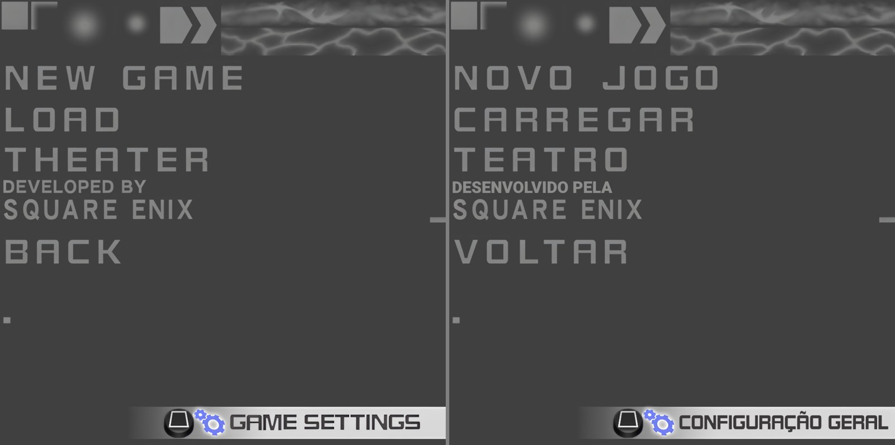
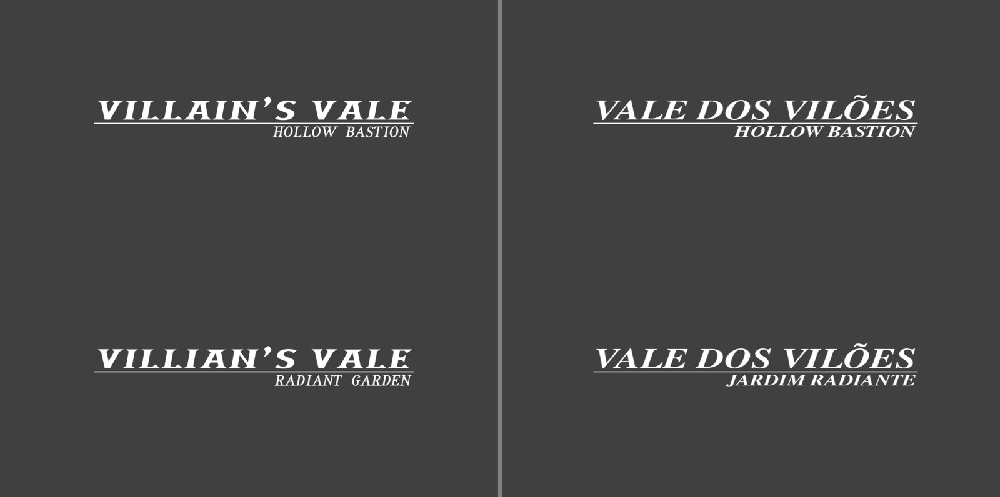
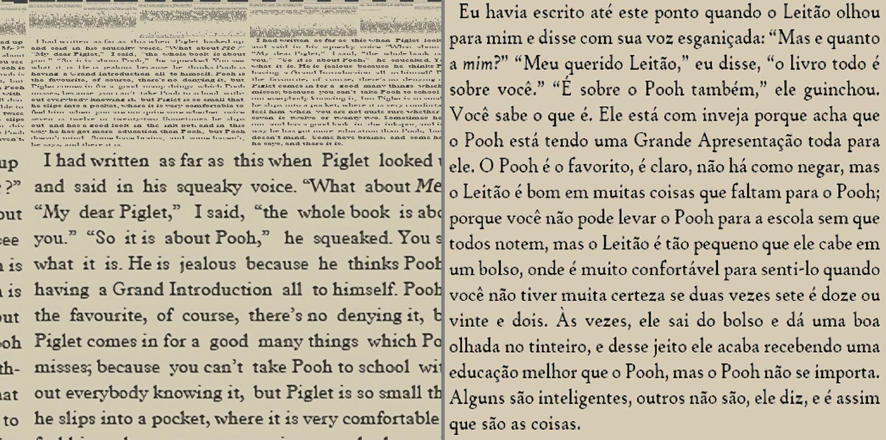

# Tradução PT-BR — Kingdom Hearts II Final Mix (KH HD 1.5+2.5 ReMIX, PS5, PPSA35901)

**Não inclui o jogo.** Só o `KH2_PS5_PTBR.patch` (diferença sobre os pacotes originais) e o instalador.

A tradução é a da Phantasie Translate para o KH2 de PC (patch `Traducao_Kh2PC`, formato KH2PC Patch Manager).
Este pacote só porta essa tradução para o dump de PS5. Não é o patch de PC.

## Comparação (original × traduzido)





## O que é traduzido

- Diálogos, legendas, menus, itens, habilidades, diário e mensagens de sistema.
- Mensagens de salvar/carregar reescritas para o PlayStation®5 (no PC elas falam de Windows).
- Fontes com acentos (ã, õ, ç…), mantendo os ícones de botão do PS.
- Texturas com texto: faixas de nome de local, cartões e HUD de missão, menus, páginas do livro do Pooh etc.
  Só o trecho com texto é trocado, então a arte em alta resolução do PS5 continua.

Ficam de fora, de propósito:

- Mudanças de jogabilidade que o patch de PC traz (scripts de área, troca de modelo de arma, tabelas de sistema).
- Ícones de botão de Xbox do PC (o PS5 mantém △ ○ ✕ □).
- A logo do grupo de tradução na abertura (as logos originais continuam).

## Requisitos

- Dump `PPSA35901-app` com `Image\dt\kh2_first.hed/.pkg`, `kh2_fifth` e `kh2_sixth`.
- ~530 MB livres no disco.
- Para o `.exe` da release, nada mais. Para rodar o `.py`, Python 3 (https://www.python.org/downloads/,
  com **Add python.exe to PATH** marcado).

## Como instalar

Mantenha juntos: `KH2_PS5_PTBR.patch`, `aplicar_traducao.exe` (ou `aplicar_traducao.py`) e `aplicar_traducao.bat`.

Dois cliques em `aplicar_traducao.exe` e escolha a pasta do jogo. Também dá para arrastar a pasta do jogo
em cima do `aplicar_traducao.bat`:

```bat
aplicar_traducao.bat "D:\caminho\PPSA35901-app"
```

O instalador confere os arquivos antes de alterar qualquer coisa. Se o dump for de outra versão
ou tiver outro mod, nada é modificado. Se for interrompido no meio, basta rodar de novo.

## Como remover

Rode o instalador de novo na mesma pasta. Ele detecta que a tradução está instalada e oferece remover,
deixando `kh2_*.hed/.pkg` idênticos ao original. Não precisa de backup.

## No console

Copie o jogo para o PS5 como de costume. O idioma do jogo continua **inglês**: o texto em português
entra no lugar do inglês. As vozes não mudam.

## Ferramentas (`ferramentas/`)

Código usado para portar o patch de PC, para quem quiser refazer ou ajustar:

| Arquivo | Função |
|---|---|
| `ps5pkg.py` | lê/grava os pacotes `kh2_*.hed/.pkg` do PS5 (round-trip idêntico ao original) |
| `gnf.py`, `dds.py` | decodifica/codifica texturas GNF (PS5) e DDS (PC) |
| `bar.py`, `msg.py` | containers BAR e tabelas de mensagem do KH2 |
| `regions.py`, `scan_regions.py`, `review.py` | detectam só os trechos traduzidos de cada textura |
| `excluir_regioes.json` | trechos ignorados (ícones de botão de Xbox) |
| `port.py` | aplica o patch de PC nos pacotes do dump (`--dry-run` / `--apply`) |
| `validate.py` | confere os pacotes gerados contra o backup do original |
| `build_patch.py` | gera o `KH2_PS5_PTBR.patch` a partir do backup e dos pacotes traduzidos |

Estrutura esperada (ou defina `KH2_ROOT`):

```
<raiz>/
  traducao.kh2pcpatch        patch de PC
  PPSA35901-app/Image/dt/    dump do PS5
  backup_ps5_original/       cópia dos kh2_*.hed/.pkg originais
```

```bat
pip install -r ferramentas\requirements.txt
python ferramentas\port.py --apply
python ferramentas\validate.py
python ferramentas\build_patch.py KH2_PS5_PTBR.patch
```

## Créditos

Tradução: Phantasie Translate (KH2 PC). Port para PS5: samuelrrs.
